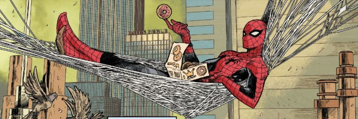
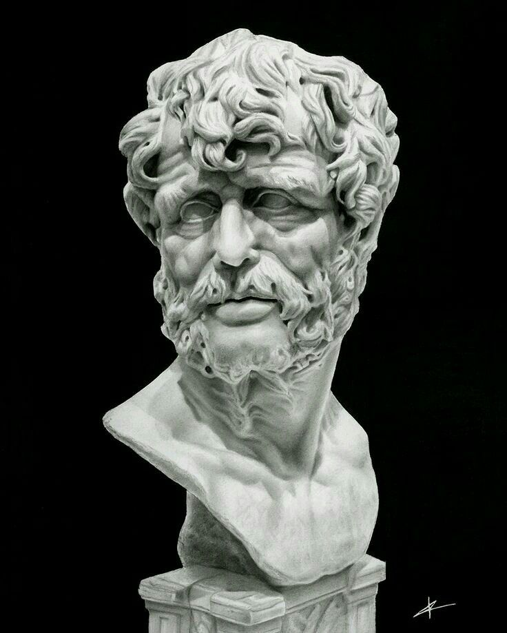
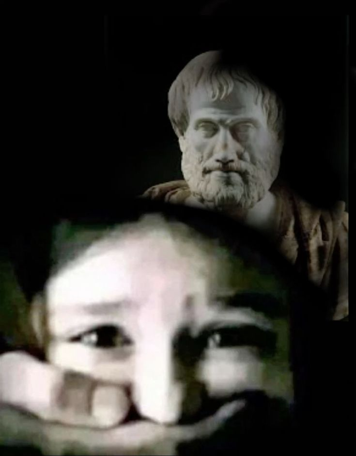
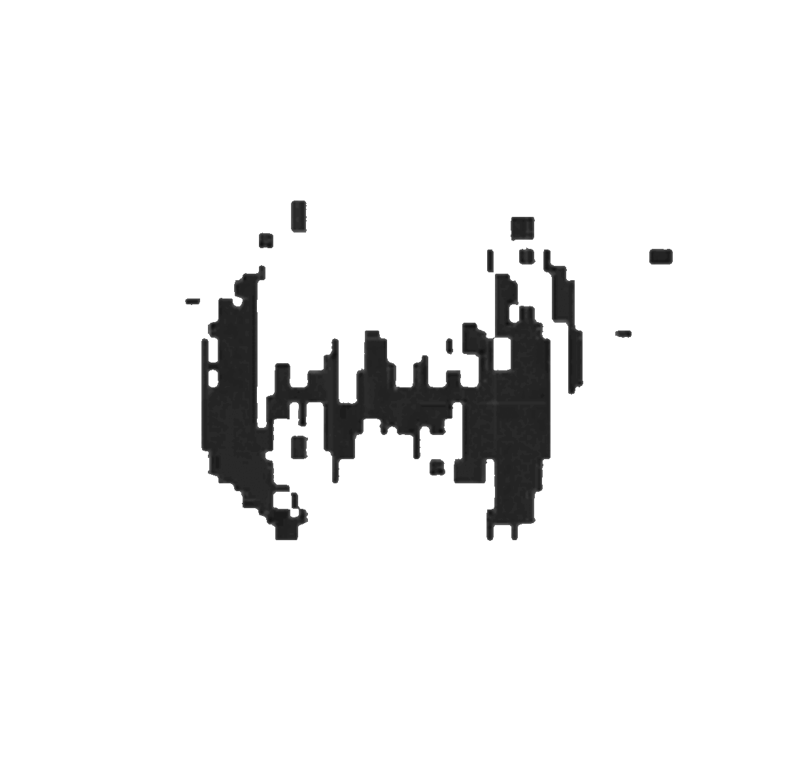
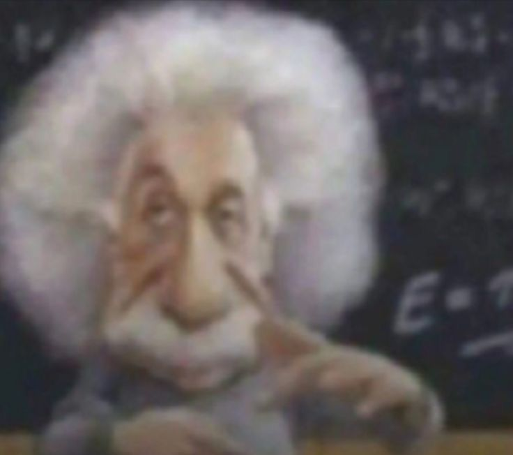

<!-- ====================== -->
<!-- 1. BANNER DO MIRANHA   -->
<!-- ====================== -->

  

 

<!-- ============================ -->
<!-- 2. TÍTULO LIMPO + SOBRE MIM  -->
<!-- ============================ -->
<h2 align="center">Opa! E aí!</h2>

  Sou o <b>Lucas</b>, estudante de <b>Engenharia Mecânica</b> com o pé na <b>programação</b> e na <b>eletrônica</b>. Curto explorar como software e hardware se conectam por pura curiosidade e diversão, sempre tirando ideias do papel na prática — o que explica a coleção de projetos e experimentos aleatórios aqui nos meus repositórios kakakkak.

 

<!-- ============================= -->
<!-- 3. PAC-MAN COMENDO OS COMMIT  -->
<!-- ============================= -->

  <picture>
    <source media="(prefers-color-scheme: dark)" srcset="https://raw.githubusercontent.com/lucxslv/lucxslv/output/pacman-contribution-graph-dark.svg" />
    <source media="(prefers-color-scheme: light)" srcset="https://raw.githubusercontent.com/lucxslv/lucxslv/output/pacman-contribution-graph.svg" />
    
  </picture>

 

<!-- ================================================ -->
<!-- 4. SÊNECA & ARISTÓTELES (Monstros brabrissimos)  -->
<!-- ================================================ -->

  <table>
    <tr>
      <td width="50%" valign="top">
        <table>
          <tr>
            <td width="76" align="center" valign="middle">
              
            </td>
            <td valign="middle">
              <i>“Não é porque as coisas são difíceis que não ousamos; é porque não ousamos que elas são difíceis.”</i> 
              <b>— Sêneca</b>
            </td>
          </tr>
        </table>
      </td>
      <td width="50%" valign="top">
        <table>
          <tr>
            <td width="76" align="center" valign="middle">
              
            </td>
            <td valign="middle">
              <i>“A excelência é uma arte conquistada pelo treinamento e pelo hábito.”</i> 
              <b>— Aristóteles</b>
            </td>
          </tr>
        </table>
      </td>
    </tr>
  </table>

 

<!-- ============================= -->
<!-- 5. FERRAMENTAS E TECNOLOGIAS  -->
<!-- ============================= -->
<h3>
  
  &nbsp;Ferramentas e tecnologias
</h3>

  
  
  
  
  
  
  
  
  
  

 

<!-- ============================ -->
<!-- 6. MORCEGO (I`am BATMAN!!!)  -->
<!-- ============================ -->

  

    
  

  

    <i>Curiosidade é um péssimo negócio.</i> 
    Você começa querendo entender uma coisa. Quando percebe, está construindo outra.
  

  

    Às vezes é código. Às vezes é matemática, um circuito ou uma ideia que 
    provavelmente daria menos trabalho se eu simplesmente deixasse pra lá.
  

  

    <b>Mas aí perderia a graça.</b>
  

 

<!-- ======================================= -->
<!-- 7. GRÁFICO DE PERFIL + EINSTEIN SABIDO  -->
<!-- ======================================= -->

  

 

  

